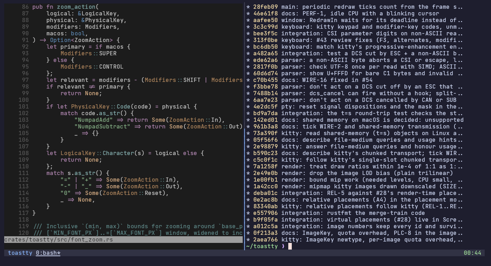
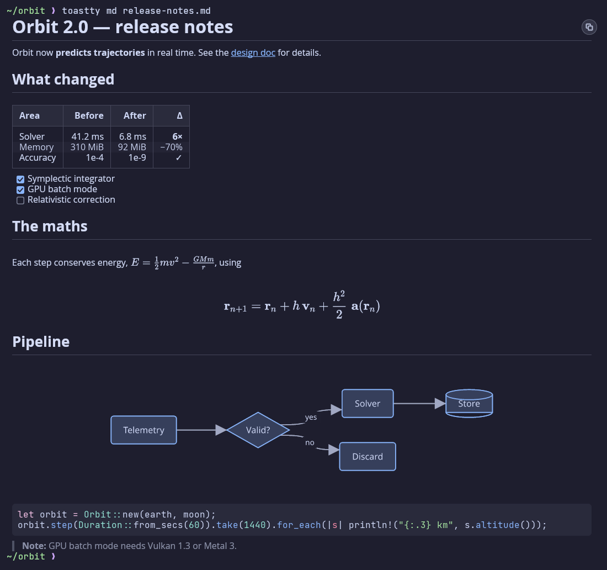
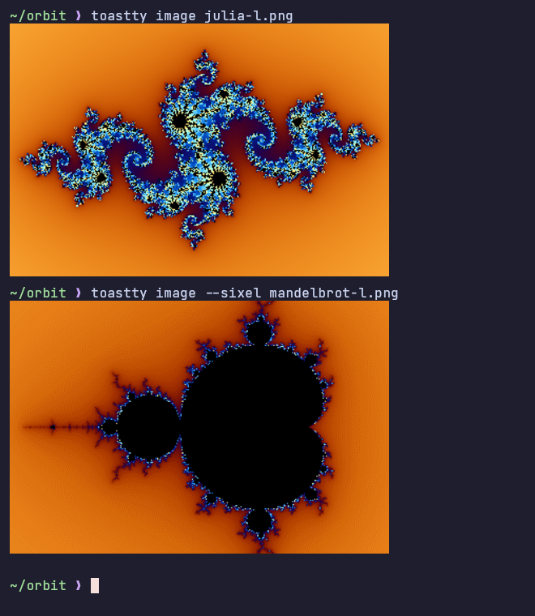
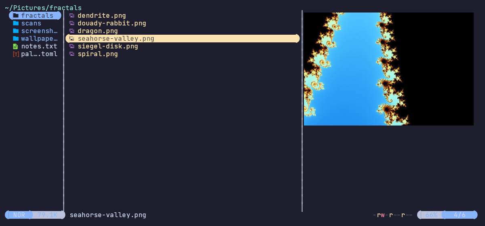
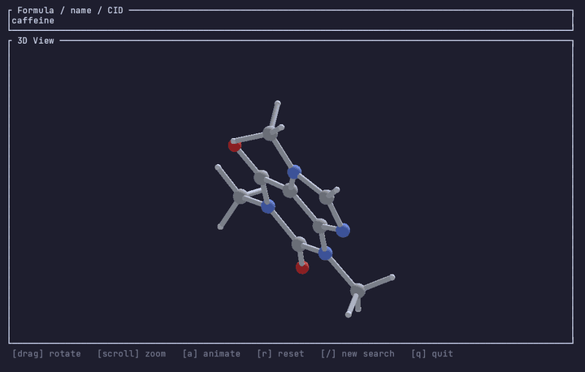
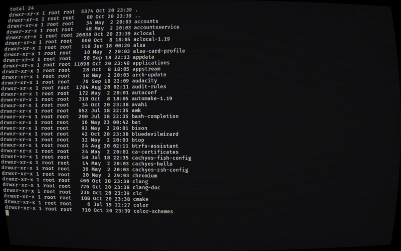
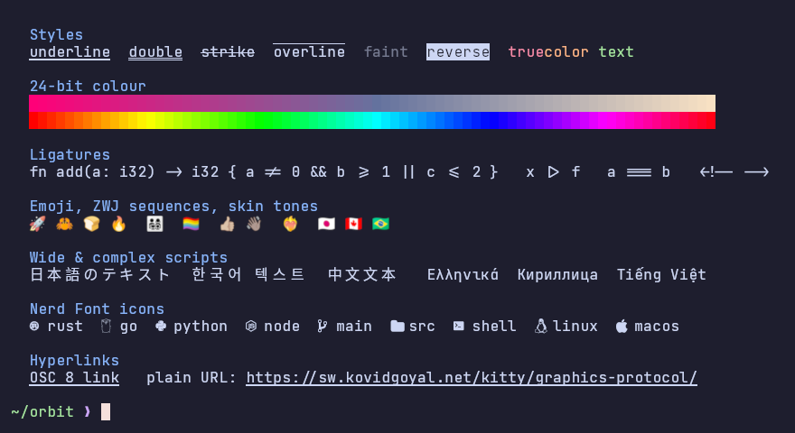
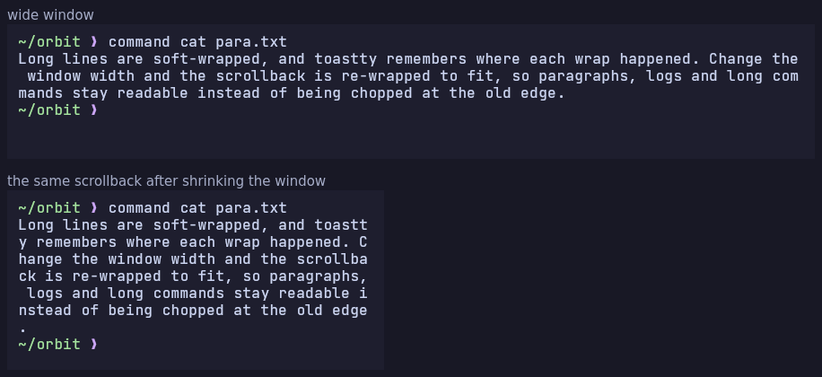

<h1 align="center">🍞 toastty</h1>

<p align="center">
  <b>A lightweight, GPU-accelerated terminal emulator in Rust,<br>
  with inline images, rendered Markdown and real 3D.</b>
</p>

<p align="center">
  <a href="#features">Features</a> ·
  <a href="#install">Install</a> ·
  <a href="#configuration">Configuration</a> ·
  <a href="#keyboard-shortcuts">Shortcuts</a> ·
  <a href="#hacking-on-toastty">Hacking</a>
</p>

<p align="center">
  
</p>

toastty draws everything on the GPU with [wgpu](https://wgpu.rs), shapes text
with [cosmic-text](https://github.com/pop-os/cosmic-text), and skips work
when nothing on screen has changed. On top of a careful xterm/VT core it
speaks the modern protocols: the kitty keyboard and graphics protocols,
Sixel, synchronized output, grapheme clusters and in-band resize. It also
adds a few things other terminals don't have, like Markdown documents
rendered in the scrollback and 3D models through the
[Ratty Graphics Protocol](https://github.com/orhun/ratty/blob/main/protocols/graphics.md).

## Features

### 📝 Markdown, rendered in the terminal

`toastty md` prints a Markdown document as a rendered block in the
scrollback: real heading sizes, tables, task lists, syntax-highlighted code,
**LaTeX maths** and **Mermaid diagrams**. It is laid out for the window
width and laid out again when the width changes. Select text to copy the
rendered text, or click the copy chip (top right) to copy the source.
Links open with Ctrl+click.

```sh
toastty md README.md
cat notes.md | toastty md
```

<p align="center">
  
</p>

Outside toastty, and inside tmux / screen / zellij for now, `toastty md`
prints the plain Markdown instead. See [docs/markdown.md](docs/markdown.md).

### 🖼️ Inline images: Kitty graphics and Sixel

Full [kitty graphics protocol](https://sw.kovidgoyal.net/kitty/graphics-protocol/)
support (placements, z-index, Unicode placeholders for tmux, relative
placements, animation frames, file and shared-memory (Linux) transfer) plus Sixel
for older tools. Images stay attached to their text through scrolling and
reflow, and are mipmapped when drawn smaller than their native size.

`toastty image` is a built-in `cat` for pictures. It reads PNG, JPEG, GIF,
WebP and BMP:

```sh
toastty image cat.png dog.jpg     # kitty graphics protocol
toastty image --sixel cat.png     # Sixel
```

<table>
  <tr>
    <td width="40%"></td>
    <td width="60%"></td>
  </tr>
  <tr>
    <td align="center"><sub><code>toastty image</code>, over kitty and Sixel</sub></td>
    <td align="center"><sub>Image previews in <a href="https://github.com/sxyazi/yazi">yazi</a></sub></td>
  </tr>
</table>

Anything that targets kitty's protocol works, including `mpv --vo=kitty`
for video in the terminal.

### 🧊 3D in the terminal

toastty is an early adopter of the **Ratty Graphics Protocol (RGP)**. Apps
upload OBJ / GLB meshes over an escape sequence and toastty renders them
live in a hand-rolled wgpu 3D pass that shares a depth buffer with the
text. The bundled [`molecule-viewer`](demos/molecule-viewer) demo fetches
any molecule from PubChem and lets you rotate and zoom it with the mouse:

```sh
cargo run --release -p molecule-viewer   # run it inside toastty
```

<p align="center">
  
</p>

### ✨ Post-processing shaders

Run your own fragment shaders over the whole terminal: CRT glass, bloom,
colour grading, cursor trails. Shaders are written in
**ShaderToy-style GLSL** (`mainImage`) or **WGSL**, and use the same
uniforms as Ghostty's custom shaders, so Ghostty shaders work unchanged.
Several shaders can be chained, and saving a shader file reloads it. A
broken edit shows its error in the window and the last working shader
keeps running.

toastty adds a few uniforms of its own. `iBells` and `iTimeBell` fire on
every BEL, with the cell it rang at, and `iCellSize` / `iGridRect`
describe the cell grid. The bundled
[`crt-splitflap.glsl`](examples/shaders/crt-splitflap.glsl) uses them for
a CRT look where each bell sends a split-flap wave across the screen:

<p align="center">
  
</p>

```toml
[shader]
paths = ["~/.config/toastty/shaders/crt-splitflap.glsl"]   # run in order
animation = "auto"   # "auto" | "always" | "never"
```

Shaders that don't use time cost nothing when the screen is idle.
toastty reads which uniforms a shader uses and only draws frames when
they can change. A shader whose animation is triggered by events can
declare `const float TOASTTY_EVENT_DURATION = 1.5;` to animate for that
long after a bell, cursor move or focus change, then go back to idle.
The full contract is in
[docs/milestones/m13-user-shaders.md](docs/milestones/m13-user-shaders.md).

### 🔤 Text that looks right

- **Ligatures** and full font fallback with cosmic-text shaping.
- **Colour emoji**, including ZWJ sequences, skin tones and flags, with
  correct widths. Mode 2027 enables full grapheme clustering.
- **CJK and other wide scripts** snapped to the cell grid.
- **Nerd Font** icons.
- **SGR styles**: underline, double underline, strikethrough, overline,
  faint, reverse, conceal, blink and 24-bit colour.
- **Hyperlinks**: OSC 8 links, and plain URLs detected in the text. Hold
  Ctrl to underline the link under the pointer, then click to open it.

<p align="center">
  
</p>

### ↔️ Reflow on resize

toastty remembers where lines soft-wrapped, so resizing the window re-wraps
the scrollback instead of chopping it. With shell integration (OSC 133),
the prompt is left alone, like kitty does, so your shell redraws it cleanly.

<p align="center">
  
</p>

### ⚡ Modern protocol support

| | |
| --- | --- |
| **Keyboard** | kitty keyboard protocol with progressive enhancement, IME preedit, dead keys |
| **Rendering** | synchronized output (2026), grapheme clusters (2027), in-band resize (2048) |
| **Shell integration** | OSC 133 semantic prompts, OSC 7 working directory ([snippets](share/shell-integration/) for bash, zsh and fish) |
| **Clipboard** | OSC 52 read and write (each can be turned off), PRIMARY selection, sanitised bracketed paste |
| **Mouse** | X10, normal, button and any-event tracking in the default, UTF-8, SGR and urxvt encodings |
| **Queries** | DA1–3, DECRQM, DECRQSS, XTGETTCAP, OSC 4 palette and OSC 11 background |
| **tmux** | DCS passthrough unwrapping, kitty Unicode placeholders |

The full matrix is in [docs/protocols.md](docs/protocols.md), and
[docs/compat-checklist.md](docs/compat-checklist.md) lists the known gaps.

### 🛋️ Small comforts

- **Smooth scrolling** through 10,000 lines of scrollback (configurable),
  for wheel and touchpad.
- A **scroll-to-bottom button** appears while you're reading history.
- **Font zoom** with Ctrl+= / Ctrl+- / Ctrl+0, which reflows like a resize.
- **Transparent backgrounds**: give the theme background an alpha, e.g.
  `bg = "#1e1e2ecc"`, and only the background goes see-through. Text
  stays opaque.
- **Config hot reload**: save `config.toml` (or a shader file) and the
  window updates.
- **Close confirmation** only when something other than the shell is running.
- **Damage-tracked redraws**: frames are only drawn when something changed.

## Install

toastty runs on **Linux** (Wayland and X11) and **macOS**. Windows support
(ConPTY) is planned.

```sh
git clone https://github.com/EDToaster/toastty
cd toastty
make install        # release build + app launcher entry (Spotlight / app menu)
```

Or build it and run it from the checkout:

```sh
cargo build --release
./target/release/toastty
```

Optional extras:

- **terminfo**: `tic -x terminfo/toastty.terminfo`, then `TERM=toastty`
  ([details](terminfo/README.md)). Without it, toastty uses
  `TERM=xterm-256color` and sets `COLORTERM=truecolor`.
- **Shell integration**: source the snippet for your shell from
  [`share/shell-integration/`](share/shell-integration/) to get OSC 7 and
  OSC 133.

## Usage

```sh
toastty                         # your shell
toastty -d ~/src                # start in a directory
toastty -- htop                 # run a program instead of the shell
toastty md notes.md             # render Markdown (inside toastty)
toastty image photo.jpg         # show an image (inside toastty)
toastty --help                  # everything else
```

## Configuration

toastty reads `~/.config/toastty/config.toml` and reloads it when it
changes. Start from the defaults:

```sh
toastty --print-default-config > ~/.config/toastty/config.toml
```

The screenshots on this page use JetBrains Mono Nerd Font and a
Catppuccin-style palette:

```toml
[font]
family = "JetBrainsMono Nerd Font"
size_px = 16.0

[theme]
fg = "#cdd6f4"
bg = "#1e1e2e"          # add an alpha, e.g. "#1e1e2ecc", for transparency
cursor = "#f5e0dc"
palette = [
    "#45475a", "#f38ba8", "#a6e3a1", "#f9e2af", "#89b4fa", "#f5c2e7", "#94e2d5", "#bac2de",
    "#585b70", "#f38ba8", "#a6e3a1", "#f9e2af", "#89b4fa", "#f5c2e7", "#94e2d5", "#a6adc8",
]

[window.padding]
top = 10
right = 12
bottom = 10
left = 12
```

Other tables cover the cursor, shell, scrollback and smooth scrolling,
window size and background extension, the scroll button, selection word
characters, post-processing `[shader]`s, and the `[security]` switches for
OSC 52 and Markdown.

## Keyboard shortcuts

| Action | Linux / Windows | macOS |
| --- | --- | --- |
| Copy selection | Ctrl+Shift+C | Cmd+C |
| Paste clipboard | Ctrl+Shift+V | Cmd+V |
| Paste PRIMARY selection | Shift+Insert | Shift+Insert (clipboard) |
| Open hyperlink | Ctrl+click | Cmd+click |
| Copy a Markdown block's source | click the copy chip shown at the block's top right on hover | same |
| Zoom in | Ctrl+= (also Ctrl++, Ctrl+Shift+=, Ctrl+keypad +) | Cmd+= (same variants) |
| Zoom out | Ctrl+- (also Ctrl+Shift+-, Ctrl+keypad -) | Cmd+- |
| Reset zoom | Ctrl+0 | Cmd+0 |

Mouse: double-click selects a word, triple-click a line, and middle-click
pastes PRIMARY. See [docs/selection.md](docs/selection.md).

<details>
<summary><b>More on <code>toastty md</code> and <code>toastty image</code></b></summary>

#### Markdown

`toastty md README.md` (or `cat notes.md | toastty md`) prints a Markdown
document as a rendered block: headings, tables, code, maths and Mermaid
diagrams, laid out for the window width and re-laid out when it changes.
Selecting text copies the rendered text; the copy chip copies the source;
links open with Ctrl+click (Cmd+click on macOS). Outside toastty, and inside
tmux / screen / zellij / herdr for now, it prints the plain Markdown. See
[docs/markdown.md](docs/markdown.md) and the `[security] markdown` /
`markdown_local_files` config keys.

#### Images

`toastty image cat.png dog.jpg` prints images inline at their native size,
one after another with a blank line between them, using the Kitty graphics
protocol; `--sixel` emits Sixel instead. Reads PNG, JPEG, GIF, WebP and BMP
(`-` reads stdin). A file that fails is reported and skipped; the command
exits non-zero.

</details>

<details>
<summary><b>How font zoom works</b></summary>

- Each step changes the font by 1 logical px, clamped to 6–72 px. A
  `font.size_px` outside that range is kept as it is: the range is widened to
  include it, so zoom never jumps away from it. Reset goes back to
  `font.size_px`.
- The zoomed size is logical, like `font.size_px`, so it is multiplied by the
  monitor scale factor (17 px on a 2× display is rasterised at 34 px).
- The window keeps its size. The grid is recomputed and goes through the same
  path as a window resize: scrollback reflow, PTY winsize (including pixel
  size, so `stty size` / `tput cols` and SIGWINCH update), and a mode 2048
  in-band resize report for apps that enabled it. The selection is cleared,
  just as it is on a window resize.
- Config hot-reload: if `font.size_px` changes, the zoom resets to the new
  size. Any other edit keeps the current zoom.
- Zoom keys are always taken by toastty and never reach the app, whatever the
  kitty keyboard protocol flags are. kitty, Ghostty and WezTerm do the same.
  This differs from copy: copy only forwards Ctrl+Shift+C under the kitty
  protocol when nothing is selected, because "no selection" leaves copy with
  nothing to do, which never happens for zoom. Shift is ignored (`+` is
  Shift+= on US layouts) and so are Caps Lock / Num Lock. Alt, or the other
  platform's modifier, turns the binding off, so Ctrl+Alt+= still reaches
  the app. With Num Lock off, keypad 0 is Insert and does not reset.
- Until configurable keybindings exist this means an app can't receive
  Ctrl+= / Ctrl+- / Ctrl+0 (Cmd on macOS).

</details>

## Hacking on toastty

See [`docs/architecture.md`](./docs/architecture.md) for high-level design,
[`docs/protocols.md`](./docs/protocols.md) for the protocol support matrix,
[`docs/selection.md`](./docs/selection.md) for mouse selection behaviour,
[`docs/compat-checklist.md`](./docs/compat-checklist.md) for known gaps,
and [`docs/decisions/`](./docs/decisions/) for individual decision records
with measurements.

### Layout

Cargo workspace under `crates/`:

| Crate | Role |
| --- | --- |
| `toastty` | Binary entry point; wires everything together |
| `toastty-pty` | PTY open/read/write (Unix; ConPTY in v2) |
| `toastty-io` | mio + winit bridge; PTY readiness + frame deadline |
| `toastty-window` | Thin winit wrapper (Caps/Num Lock, IME, dead keys) |
| `toastty-parser` | vte wrapper + our own streaming APC scanner |
| `toastty-term` | Grid (ring buffer), modes, cursor, scrollback, damage tracking |
| `toastty-protocols` | One module per protocol handler |
| `toastty-graphics` | Kitty graphics, Sixel, RGP decoders |
| `toastty-markdown` | Markdown → laid-out block (maths, Mermaid, syntax highlighting) |
| `toastty-render` | wgpu renderer; cosmic-text shaping; image, 3D and post-process shader passes |
| `toastty-config` | TOML config loading |

Demos live under `demos/` (`molecule-viewer`), example shaders under
`examples/shaders/`.

### Development

```sh
make check         # cargo check --workspace --all-targets
make lint          # clippy with -D warnings
make fmt           # rustfmt
make test          # cargo test --workspace
make cover         # coverage summary
make cover-gate    # fail if <95% on gated crates
make cover-html    # generate browsable HTML coverage report
```

Install the coverage tool once with `cargo install cargo-llvm-cov`.

### Testing conventions

- **Logic crates** (`parser`, `term`, `protocols`, `config`, `graphics`,
  pure-function submodules of `render`): **95% line coverage gate** enforced
  by `make cover-gate`.
- **I/O crates** (`pty`, `io`): covered by integration tests using real PTYs
  and child processes. Excluded from the line gate.
- **Window crate**: covered by integration tests that script winit's
  `EventLoop`. Excluded from the line gate.
- **Render crate**: pure-function submodules (`layout`, `atlas`, `viewport`,
  `damage`, `cluster_width`) are gated. Pipeline/device code is exercised by:
  - **`build.rs`** validates every `.wgsl` shader via `naga` at build time.
  - **Headless snapshot tests** under `crates/toastty-render/tests/` use
    a hidden wgpu device, render canonical scenarios, and diff against
    golden images with `image-compare` (SSIM threshold).
  - **wgpu validation** is enabled in tests via `cfg(test)` flags.
  - **Property tests** (`proptest`) exercise grid → instance buffer
    transformations.

## License

Dual-licensed under MIT or Apache-2.0, as declared in `Cargo.toml`.
