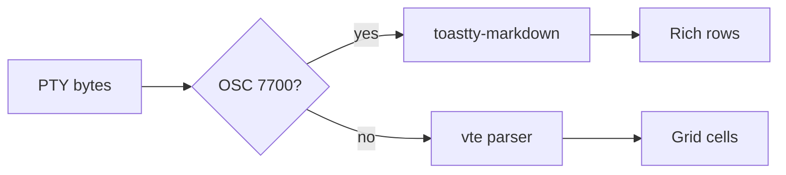
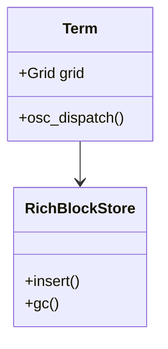
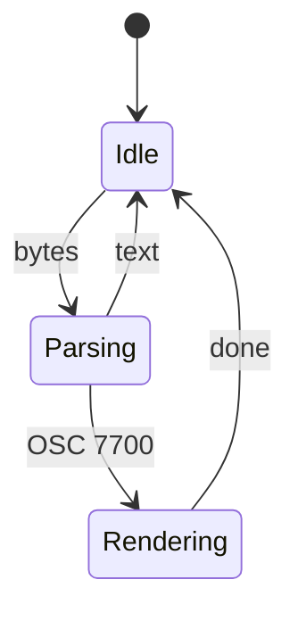
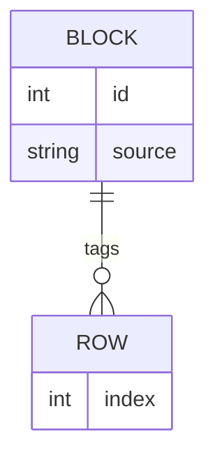
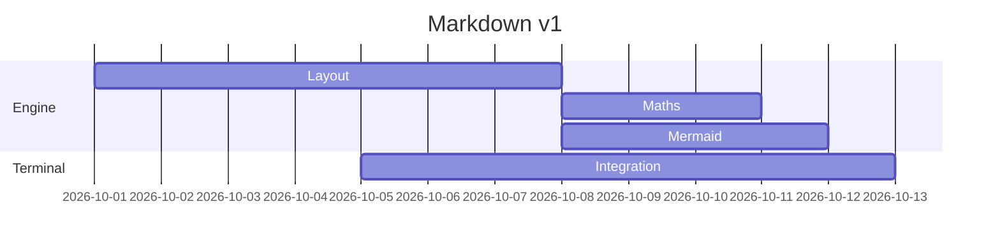
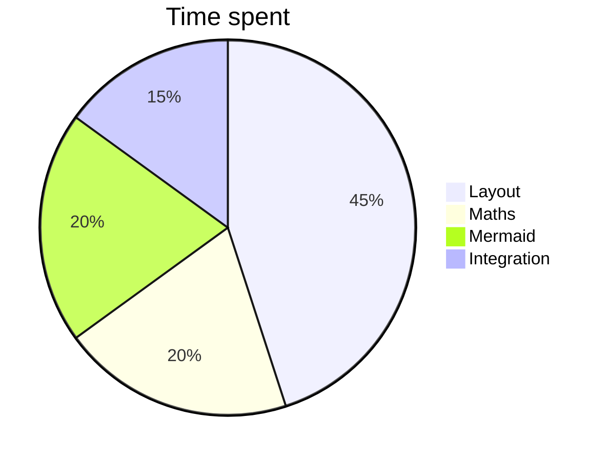

# toastty Markdown demo

Run `toastty md toastty-markdown-demo.md` in toastty (not inside tmux or herdr). Try scrolling back, resizing the window, selecting text, Ctrl/Cmd+clicking links, and the copy chip at the top right of the block.

## Headings

# H1 heading
## H2 heading
### H3 heading
#### H4 heading
##### H5 heading
###### H6 heading

Setext heading
--------------

## Inline styles

Plain text with **bold**, *italic*, ***bold italic***, ~~strikethrough~~, `inline code`, and **`bold code`**. Smart quotes stay "as typed" and so do -- dashes.

This paragraph is deliberately long so you can watch it wrap and re-flow when you make the window narrower or wider. Lorem ipsum dolor sit amet, consectetur adipiscing elit, sed do eiusmod tempor incididunt ut labore et dolore magna aliqua. Ut enim ad minim veniam, quis nostrud exercitation ullamco laboris.

Line one with a hard break  
line two after the break.

## Links

- Inline: [toastty on GitHub](https://github.com/EDToaster/toastty)
- Reference: [CommonMark spec][cm]
- Autolink: <https://www.rust-lang.org>
- Link with **bold** text: [**bold link**](https://example.com)

[cm]: https://spec.commonmark.org

## Lists

- Unordered item
- Another item
  - Nested item
    - Deeper nested item
      - Deepest item
- Back to the top level

1. First
2. Second
   1. Nested ordered
   2. Another nested
3. Third
10. Ten (numbers right-align)

5. A list starting at five
6. Six

- [x] Completed task
- [ ] Open task
  - [x] Nested completed task
  - [ ] Nested open task

- A loose list item

  with a second paragraph.

- Another loose item

## Block quotes and alerts

> A simple quote.
>
> > A nested quote inside it.
> >
> > > And one more level.

> [!NOTE]
> Useful information that users should know.

> [!TIP]
> Helpful advice for doing things better.

> [!IMPORTANT]
> Key information users need to know.

> [!WARNING]
> Urgent info that needs immediate attention.

> [!CAUTION]
> Advises about risks or negative outcomes.

## Code

```rust
use std::collections::HashMap;

/// Count words in a string.
fn count(text: &str) -> HashMap<&str, usize> {
    let mut map = HashMap::new();
    for word in text.split_whitespace() {
        *map.entry(word).or_insert(0) += 1;
    }
    map
}
```

```python
def fib(n: int) -> int:
    """Return the n-th Fibonacci number."""
    a, b = 0, 1
    for _ in range(n):
        a, b = b, a + b
    return a
```

```javascript
const greet = (name) => console.log(`hello, ${name}`);
greet("toastty");
```

```bash
for f in *.md; do
  toastty md "$f"
done
```

```json
{ "name": "toastty", "features": ["markdown", "maths", "mermaid"], "fast": true }
```

```unknown-language
Unknown languages render as plain monospace text.
```

    Indented code block (four spaces).

```text
A very long line that should wrap inside the code panel instead of running off the edge of the block: aaaaaaaaaaaaaaaaaaaaaaaaaaaaaaaaaaaaaaaaaaaaaaaaaaaaaa
```

## Tables

| Left aligned | Centered | Right aligned |
| :----------- | :------: | ------------: |
| apple        | 1        | 1.00          |
| banana       | 22       | 22.50         |
| cherry       | 333      | 333.75        |

| Feature | Notes |
| --- | --- |
| **Wrapping** | This cell has a lot of text in it so the table has to wrap cells when the window is narrow. Make the window smaller to see it. |
| `code` in cells | And [links](https://example.com) too |
| Maths in cells | $a^2 + b^2 = c^2$ |

## Horizontal rules

Above the rule.

---

Below the rule.

## Images

Embedded `data:` image (always shown):

![gradient](data:image/png;base64,iVBORw0KGgoAAAANSUhEUgAAAGAAAAAwCAYAAADuFn/PAAAWv0lEQVR42hXX8UcD8L7/8ePLmBETY7pixphdMdIVE13piold6YpudEU3utIV3dE1uaMbc5MbXcmNbuRObmTkJjcyciIjNzEy5k6MjJgY0ffRD4+/4Mnn83794Q9/+OPP/yNAkBB9hOknQpQBBokRJ0GSFEOkGWaEUTKMMc4Ek0yRZZocM8wyxzwLLLLEMiusssY6G2ySZ4sC2xTZYZcSe+xzwCFHHHPCKWecU+aCS66ocM0Nt9xxT5UHHnmixjMvvFLnjQZNWrzT5oMOn3T5osc3P/zhDwEBCBAkRB9h+okQZYBBYsRJkCTFEGmGGWGUDGOMM8EkU2SZJscMs8wxzwKLLLHMCqussc4Gm+TZosA2RXbYpcQe+xxwyBHHnHDKGeeUueCSKypcc8Mtd9xT5YFHnqjxzAuv1HmjQZMW77T5oMMnXb7o8c1P4DdASAACBAnRR5h+IkQZYJAYcRIkSTFEmmFGGCXDGONMMMkUWabJMcMsc8yzwCJLLLPCKmuss8EmebYosE2RHXYpscc+BxxyxDEnnHLGOWUuuOSKCtfccMsd91R54JEnajzzwit13mjQpMU7bT7o8EmXL3p88xP6DRAWgABBQvQRpp8IUQYYJEacBElSDJFmmBFGyTDGOBNMMkWWaXLMMMsc8yywyBLLrLDKGutssEmeLQpsU2SHXUrssc8BhxxxzAmnnHFOmQsuuaLCNTfccsc9VR545Ikaz7zwSp03GjRp8U6bDzp80uWLHt/8hH8DRAQgQJAQfYTpJ0KUAQaJESdBkhRDpBlmhFEyjDHOBJNMkWWaHDPMMsc8CyyyxDIrrLLGOhtskmeLAtsU2WGXEnvsc8AhRxxzwilnnFPmgkuuqHDNDbfccU+VBx55osYzL7xS540GTVq80+aDDp90+aLHNz+R3wB/IgABgoToI0w/EaIMMEiMOAmSpBgizTAjjJJhjHEmmGSKLNPkmGGWOeZZYJEllllhlTXW2WCTPFsU2KbIDruU2GOfAw454pgTTjnjnDIXXHJFhWtuuOWOe6o88MgTNZ554ZU6bzRo0uKdNh90+KTLFz2++fmT3wAxAQgQJEQfYfqJEGWAQWLESZAkxRBphhlhlAxjjDPBJFNkmSbHDLPMMc8CiyyxzAqrrLHOBpvk2aLANkV22KXEHvsccMgRx5xwyhnnlLngkisqXHPDLXfcU+WBR56o8cwLr9R5o0GTFu+0+aDDJ12+6PHNT+w3QEIAAgQJ0UeYfiJEGWCQGHESJEkxRJphRhglwxjjTDDJFFmmyTHDLHPMs8AiSyyzwiprrLPBJnm2KLBNkR12KbHHPgcccsQxJ5xyxjllLrjkigrX3HDLHfdUeeCRJ2o888Irdd5o0KTFO20+6PBJly96fPOT+A3wpwIQIEiIPsL0EyHKAIPEiJMgSYoh0gwzwigZxhhngkmmyDJNjhlmmWOeBRZZYpkVVlljnQ02ybNFgW2K7LBLiT32OeCQI4454ZQzzilzwSVXVLjmhlvuuKfKA488UeOZF16p80aDJi3eafNBh0+6fNHjm58//Q2QFoAAQUL0EaafCFEGGCRGnARJUgyRZpgRRskwxjgTTDJFlmlyzDDLHPMssMgSy6ywyhrrbLBJni0KbFNkh11K7LHPAYccccwJp5xxTpkLLrmiwjU33HLHPVUeeOSJGs+88EqdNxo0afFOmw86fNLlix7f/KR/A/yZAAQIEqKPMP1EiDLAIDHiJEiSYog0w4wwSoYxxplgkimyTJNjhlnmmGeBRZZYZoVV1lhng03ybFFgmyI77FJij30OOOSIY0445YxzylxwyRUVrrnhljvuqfLAI0/UeOaFV+q80aBJi3fafNDhky5f9Pjm589+A2QEIECQEH2E6SdClAEGiREnQZIUQ6QZZoRRMowxzgSTTJFlmhwzzDLHPAssssQyK6yyxjobbJJniwLbFNlhlxJ77HPAIUccc8IpZ5xT5oJLrqhwzQ233HFPlQceeaLGMy+8UueNBk1avNPmgw6fdPmixzc/md8Afy4AAYKE6CNMPxGiDDBIjDgJkqQYIs0wI4ySYYxxJphkiizT5JhhljnmWWCRJZZZYZU11tlgkzxbFNimyA67lNhjnwMOOeKYE04545wyF1xyRYVrbrjljnuqPPDIEzWeeeGVOm80aNLinTYfdPikyxc9vvn5898AfyEAAYKE6CNMPxGiDDBIjDgJkqQYIs0wI4ySYYxxJphkiizT5JhhljnmWWCRJZZZYZU11tlgkzxbFNimyA67lNhjnwMOOeKYE04545wyF1xyRYVrbrjljnuqPPDIEzWeeeGVOm80aNLinTYfdPikyxc9vvn5i98AWQEIECREH2H6iRBlgEFixEmQJMUQaYYZYZQMY4wzwSRTZJkmxwyzzDHPAossscwKq6yxzgab5NmiwDZFdtilxB77HHDIEceccMoZ55S54JIrKlxzwy133FPlgUeeqPHMC6/UeaNBkxbvtPmgwyddvujxzU/2N8BfCkCAICH6CNNPhCgDDBIjToIkKYZIM8wIo2QYY5wJJpkiyzQ5ZphljnkWWGSJZVZYZY11NtgkzxYFtimywy4l9tjngEOOOOaEU844p8wFl1xR4ZobbrnjnioPPPJEjWdeeKXOGw2atHinzQcdPunyRY9vfv7yN8BfCUCAICH6CNNPhCgDDBIjToIkKYZIM8wIo2QYY5wJJpkiyzQ5ZphljnkWWGSJZVZYZY11NtgkzxYFtimywy4l9tjngEOOOOaEU844p8wFl1xR4ZobbrnjnioPPPJEjWdeeKXOGw2atHinzQcdPunyRY9vfv7qN8BfC0CAICH6CNNPhCgDDBIjToIkKYZIM8wIo2QYY5wJJpkiyzQ5ZphljnkWWGSJZVZYZY11NtgkzxYFtimywy4l9tjngEOOOOaEU844p8wFl1xR4ZobbrnjnioPPPJEjWdeeKXOGw2atHinzQcdPunyRY9vfv76N8DfCECAICH6CNNPhCgDDBIjToIkKYZIM8wIo2QYY5wJJpkiyzQ5ZphljnkWWGSJZVZYZY11NtgkzxYFtimywy4l9tjngEOOOOaEU844p8wFl1xR4ZobbrnjnioPPPJEjWdeeKXOGw2atHinzQcdPunyRY9vfv7mN8DfCkCAICH6CNNPhCgDDBIjToIkKYZIM8wIo2QYY5wJJpkiyzQ5ZphljnkWWGSJZVZYZY11NtgkzxYFtimywy4l9tjngEOOOOaEU844p8wFl1xR4ZobbrnjnioPPPJEjWdeeKXOGw2atHinzQcdPunyRY9vfv72N8DfCUCAICH6CNNPhCgDDBIjToIkKYZIM8wIo2QYY5wJJpkiyzQ5ZphljnkWWGSJZVZYZY11NtgkzxYFtimywy4l9tjngEOOOOaEU844p8wFl1xR4ZobbrnjnioPPPJEjWdeeKXOGw2atHinzQcdPunyRY9vfv7uN8DfC0CAICH6CNNPhCgDDBIjToIkKYZIM8wIo2QYY5wJJpkiyzQ5ZphljnkWWGSJZVZYZY11NtgkzxYFtimywy4l9tjngEOOOOaEU844p8wFl1xR4ZobbrnjnioPPPJEjWdeeKXOGw2atHinzQcdPunyRY9vfv7+N8A/CECAICH6CNNPhCgDDBIjToIkKYZIM8wIo2QYY5wJJpkiyzQ5ZphljnkWWGSJZVZYZY11NtgkzxYFtimywy4l9tjngEOOOOaEU844p8wFl1xR4ZobbrnjnioPPPJEjWdeeKXOGw2atHinzQcdPunyRY9vfv7hN8A/CkCAICH6CNNPhCgDDBIjToIkKYZIM8wIo2QYY5wJJpkiyzQ5ZphljnkWWGSJZVZYZY11NtgkzxYFtimywy4l9tjngEOOOOaEU844p8wFl1xR4ZobbrnjnioPPPJEjWdeeKXOGw2atHinzQcdPunyRY9vfv7xN8A/CUCAICH6CNNPhCgDDBIjToIkKYZIM8wIo2QYY5wJJpkiyzQ5ZphljnkWWGSJZVZYZY11NtgkzxYFtimywy4l9tjngEOOOOaEU844p8wFl1xR4ZobbrnjnioPPPJEjWdeeKXOGw2atHinzQcdPunyRY9vfv7pN8A/C0CAICH6CNNPhCgDDBIjToIkKYZIM8wIo2QYY5wJJpkiyzQ5ZphljnkWWGSJZVZYZY11NtgkzxYFtimywy4l9tjngEOOOOaEU844p8wFl1xR4ZobbrnjnioPPPJEjWdeeKXOGw2atHinzQcdPunyRY9vfv75N8C/CECAICH6CNNPhCgDDBIjToIkKYZIM8wIo2QYY5wJJpkiyzQ5ZphljnkWWGSJZVZYZY11NtgkzxYFtimywy4l9tjngEOOOOaEU844p8wFl1xR4ZobbrnjnioPPPJEjWdeeKXOGw2atHinzQcdPunyRY9vfv7lN8C/CkCAICH6CNNPhCgDDBIjToIkKYZIM8wIo2QYY5wJJpkiyzQ5ZphljnkWWGSJZVZYZY11NtgkzxYFtimywy4l9tjngEOOOOaEU844p8wFl1xR4ZobbrnjnioPPPJEjWdeeKXOGw2atHinzQcdPunyRY9vfv71N8C/CUCAICH6CNNPhCgDDBIjToIkKYZIM8wIo2QYY5wJJpkiyzQ5ZphljnkWWGSJZVZYZY11NtgkzxYFtimywy4l9tjngEOOOOaEU844p8wFl1xR4ZobbrnjnioPPPJEjWdeeKXOGw2atHinzQcdPunyRY9vfv7tN8C/C0CAICH6CNNPhCgDDBIjToIkKYZIM8wIo2QYY5wJJpkiyzQ5ZphljnkWWGSJZVZYZY11NtgkzxYFtimywy4l9tjngEOOOOaEU844p8wFl1xR4ZobbrnjnioPPPJEjWdeeKXOGw2atHinzQcdPunyRY9vfv79N8B/CECAICH6CNNPhCgDDBIjToIkKYZIM8wIo2QYY5wJJpkiyzQ5ZphljnkWWGSJZVZYZY11NtgkzxYFtimywy4l9tjngEOOOOaEU844p8wFl1xR4ZobbrnjnioPPPJEjWdeeKXOGw2atHinzQcdPunyRY9vfv7jN8B/CkCAICH6CNNPhCgDDBIjToIkKYZIM8wIo2QYY5wJJpkiyzQ5ZphljnkWWGSJZVZYZY11NtgkzxYFtimywy4l9tjngEOOOOaEU844p8wFl1xR4ZobbrnjnioPPPJEjWdeeKXOGw2atHinzQcdPunyRY9vfv7zN8B/CUCAICH6CNNPhCgDDBIjToIkKYZIM8wIo2QYY5wJJpkiyzQ5ZphljnkWWGSJZVZYZY11NtgkzxYFtimywy4l9tjngEOOOOaEU844p8wFl1xR4ZobbrnjnioPPPJEjWdeeKXOGw2atHinzQcdPunyRY9vfv7rN0BFAAIECdFHmH4iRBlgkBhxEiRJMUSaYUYYJcMY40wwyRRZpskxwyxzzLPAIksss8Iqa6yzwSZ5tiiwTZEddimxxz4HHHLEMSeccsY5ZS645IoK19xwyx33VHngkSdqPPPCK3XeaNCkxTttPujwSZcvenzzU/kN8N8CECBIiD7C9BMhygCDxIiTIEmKIdIMM8IoGcYYZ4JJpsgyTY4ZZpljngUWWWKZFVZZY50NNsmzRYFtiuywS4k99jngkCOOOeGUM84pc8ElV1S45oZb7rinygOPPFHjmRdeqfNGgyYt3mnzQYdPunzR45uf//4N8D8CECBIiD7C9BMhygCDxIiTIEmKIdIMM8IoGcYYZ4JJpsgyTY4ZZpljngUWWWKZFVZZY50NNsmzRYFtiuywS4k99jngkCOOOeGUM84pc8ElV1S45oZb7rinygOPPFHjmRdeqfNGgyYt3mnzQYdPunzR45uf//kNUBWAAEFC9BGmnwhRBhgkRpwESVIMkWaYEUbJMMY4E0wyRZZpcswwyxzzLLDIEsussMoa62ywSZ4tCmxTZIddSuyxzwGHHHHMCaeccU6ZCy65osI1N9xyxz1VHnjkiRrPvPBKnTcaNGnxTpsPOnzS5Yse3/xUfwP8UQACBAnRR5h+IkQZYJAYcRIkSTFEmmFGGCXDGONMMMkUWabJMcMsc8yzwCJLLLPCKmuss8EmebYosE2RHXYpscc+BxxyxDEnnHLGOWUuuOSKCtfccMsd91R54JEnajzzwit13mjQpMU7bT7o8EmXL3p88/PH3wA1AQgQJEQfYfqJEGWAQWLESZAkxRBphhlhlAxjjDPBJFNkmSbHDLPMMc8CiyyxzAqrrLHOBpvk2aLANkV22KXEHvsccMgRx5xwyhnnlLngkisqXHPDLXfcU+WBR56o8cwLr9R5o0GTFu+0+aDDJ12+6PGNkgL8rwAECBKijzD9RIgywCAx4iRIkmKINMOMMEqGMcaZYJIpskyTY4ZZ5phngUWWWGaFVdZYZ4NN8mxRYJsiO+xSYo99DjjkiGNOOOWMc8pccMkVFa654ZY77qnywCNP1HjmhVfqvNGgSYt32nzQ4ZMuX/T45ud/fwPUBSBAkBB9hOknQpQBBokRJ0GSFEOkGWaEUTKMMc4Ek0yRZZocM8wyxzwLLLLEMiusssY6G2ySZ4sC2xTZYZcSe+xzwCFHHHPCKWecU+aCS66ocM0Nt9xxT5UHHnmixjMvvFLnjQZNWrzT5oMOn3T5osc33i4BGgIQIEiIPsL0EyHKAIPEiJMgSYoh0gwzwigZxhhngkmmyDJNjhlmmWOeBRZZYpkVVlljnQ02ybNFgW2K7LBLiT32OeCQI4454ZQzzilzwSVXVLjmhlvuuKfKA488UeOZF16p80aDJi3eafNBh0+6fNHjG5+GAP8nAAGChOgjTD8RogwwSIw4CZKkGCLNMCOMkmGMcSaYZIos0+SYYZY55llgkSWWWWGVNdbZYJM8WxTYpsgOu5TYY58DDjnimBNOOeOcMhdcckWFa2645Y57qjzwyBM1nnnhlTpvNGjS4p02H3T4pMsXPb75+b/fAG0BCBAkRB9h+okQZYBBYsRJkCTFEGmGGWGUDGOMM8EkU2SZJscMs8wxzwKLLLHMCqussc4Gm+TZosA2RXbYpcQe+xxwyBHHnHDKGeeUueCSKypcc8Mtd9xT5YFHnqjxzAuv1HmjQZMW77T5oMMnXb7o8Y0zSYCOAAQIEqKPMP1EiDLAIDHiJEiSYog0w4wwSoYxxplgkimyTJNjhlnmmGeBRZZYZoVV1lhng03ybFFgmyI77FJij30OOOSIY0445YxzylxwyRUVrrnhljvuqfLAI0/UeOaFV+q80aBJi3fafNDhky5f9PjGfSpAVwACBAnRR5h+IkQZYJAYcRIkSTFEmmFGGCXDGONMMMkUWabJMcMsc8yzwCJLLLPCKmuss8EmebYosE2RHXYpscc+BxxyxDEnnHLGOWUuuOSKCtfccMsd91R54JEnajzzwit13mjQpMU7bT7o8EmXL3p8YxgI0BOAAEFC9BGmnwhRBhgkRpwESVIMkWaYEUbJMMY4E0wyRZZpcswwyxzzLLDIEsussMoa62ywSZ4tCmxTZIddSuyxzwGHHHHMCaeccU6ZCy65osI1N9xyxz1VHnjkiRrPvPBKnTcaNGnxTpsPOnzS5Yse31hkAvwIQIAgIfoI00+EKAMMEiNOgiQphkgzzAijZBhjnAkmmSLLNDlmmGWOeRZYZIllVlhljXU22CTPFgW2KbLDLiX22OeAQ4445oRTzjinzAWXXFHhmhtuueOeKg888kSNZ154pc4bDZq0eKfNBx0+6fJFj29M4Z//D07I3dAeodLOAAAAAElFTkSuQmCC)

Remote image (never fetched, alt text shown in a placeholder):


Local file (shown only with `[security] markdown_local_files = true`):


## Maths

Inline maths sits on the baseline: Euler's identity $e^{i\pi} + 1 = 0$, a fraction $\frac{a}{b}$, a root $\sqrt{x^2 + y^2}$, and Greek $\alpha, \beta, \gamma, \Omega$.

Display maths with dollar signs:

$$
\int_{-\infty}^{\infty} e^{-x^2}\,dx = \sqrt{\pi}
$$

$$
\sum_{n=1}^{\infty} \frac{1}{n^2} = \frac{\pi^2}{6}
\qquad
\lim_{x \to 0} \frac{\sin x}{x} = 1
$$

A fenced `math` block:

```math
\begin{pmatrix} a & b \\ c & d \end{pmatrix}^{-1}
= \frac{1}{ad - bc} \begin{pmatrix} d & -b \\ -c & a \end{pmatrix}
```

```math
f(x) = \begin{cases} x^2 & \text{if } x \ge 0 \\ -x & \text{otherwise} \end{cases}
```

```math
\nabla \times \mathbf{E} = -\frac{\partial \mathbf{B}}{\partial t}
```

Colour: $\color{red}{x} + \textcolor{blue}{y}$

Invalid maths falls back to code: $\frac{a$

## Mermaid

Flowchart:



Sequence diagram:

```mermaid
sequenceDiagram
  participant Shell
  participant toastty
  participant Renderer
  Shell->>toastty: OSC 7700 ; md ; ; base64
  toastty->>Renderer: layout(markdown, width)
  Renderer-->>toastty: image + text rows
  Note over toastty: rows tagged in the grid
  toastty-->>Shell: cursor below the block
```

Class diagram:



State diagram:



Entity relationship:



Gantt chart:



Pie chart:



Invalid Mermaid falls back to its source:

```mermaid
notadiagram
  A --> B
```

## Other

Raw HTML is shown as text: <span style="color:red">not rendered</span>

<details><summary>HTML block</summary>Shown as text in v1.</details>

A footnote reference[^1] and another[^note].

[^1]: The first footnote.
[^note]: A named footnote.

Escaped characters: \*not italic\*, \`not code\`, \$not maths\$.

Unicode: café, naïve, Ελληνικά, Русский. CJK and emoji depend on your system fonts: 你好 👋

---

End of the demo.
