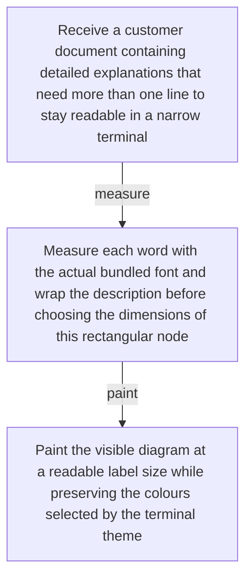
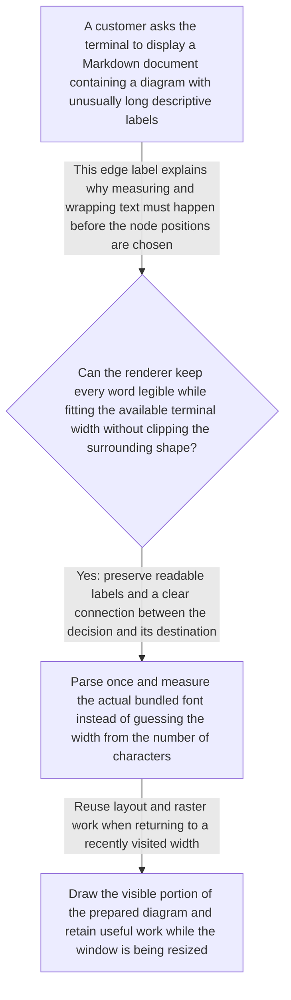
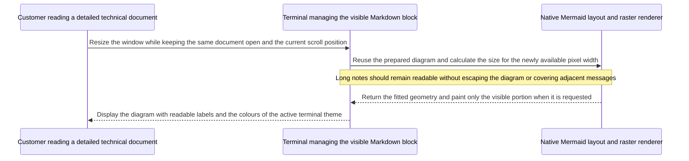

# Mermaid responsive stress demo

Run `toastty md docs/fixtures/mermaid-responsive.md` inside toastty, then
resize the window between roughly 40 and 120 columns. Check that the
labels remain inside their shapes, edge labels do not cover nodes, and
the diagram does not become unreadable merely because one label is long.
The first two diagrams are positive rendering examples. The final three
are intentional stress cases: a readable source-code fallback is preferable
to tiny text when the upstream layout cannot safely wrap an edge label.
The native benchmark uses these same sources.

## Wrapped rectangular nodes

## Tall sequence for viewport painting

Only part of this diagram is visible at once. Scroll down, resize the
window, then return to a recently visited width and scroll position.

```mermaid
sequenceDiagram
    participant T as Terminal
    participant R as Renderer
    T->>R: Request 01
    R-->>T: Result 01
    T->>R: Request 02
    R-->>T: Result 02
    T->>R: Request 03
    R-->>T: Result 03
    T->>R: Request 04
    R-->>T: Result 04
    T->>R: Request 05
    R-->>T: Result 05
    T->>R: Request 06
    R-->>T: Result 06
    T->>R: Request 07
    R-->>T: Result 07
    T->>R: Request 08
    R-->>T: Result 08
    T->>R: Request 09
    R-->>T: Result 09
    T->>R: Request 10
    R-->>T: Result 10
    T->>R: Request 11
    R-->>T: Result 11
    T->>R: Request 12
    R-->>T: Result 12
    T->>R: Request 13
    R-->>T: Result 13
    T->>R: Request 14
    R-->>T: Result 14
    T->>R: Request 15
    R-->>T: Result 15
    T->>R: Request 16
    R-->>T: Result 16
    T->>R: Request 17
    R-->>T: Result 17
    T->>R: Request 18
    R-->>T: Result 18
    T->>R: Request 19
    R-->>T: Result 19
    T->>R: Request 20
    R-->>T: Result 20
    T->>R: Request 21
    R-->>T: Result 21
    T->>R: Request 22
    R-->>T: Result 22
    T->>R: Request 23
    R-->>T: Result 23
    T->>R: Request 24
    R-->>T: Result 24
    T->>R: Request 25
    R-->>T: Result 25
    T->>R: Request 26
    R-->>T: Result 26
    T->>R: Request 27
    R-->>T: Result 27
    T->>R: Request 28
    R-->>T: Result 28
    T->>R: Request 29
    R-->>T: Result 29
    T->>R: Request 30
    R-->>T: Result 30
    T->>R: Request 31
    R-->>T: Result 31
    T->>R: Request 32
    R-->>T: Result 32
    T->>R: Request 33
    R-->>T: Result 33
    T->>R: Request 34
    R-->>T: Result 34
    T->>R: Request 35
    R-->>T: Result 35
    T->>R: Request 36
    R-->>T: Result 36
    T->>R: Request 37
    R-->>T: Result 37
    T->>R: Request 38
    R-->>T: Result 38
    T->>R: Request 39
    R-->>T: Result 39
    T->>R: Request 40
    R-->>T: Result 40
```

## Long node and edge labels

## Wide left-to-right flow

```mermaid
flowchart LR
    A["Receive a document with detailed customer-facing descriptions"] -->|"Validate the source without discarding useful context"| B["Parse Markdown and identify every embedded Mermaid block"]
    B -->|"Keep the parsed representation available during a resize"| C["Measure labels using the bundled regular and bold fonts"]
    C -->|"Reserve space for words as well as arrowheads"| D["Place nodes and route their labelled connections"]
    D -->|"Rasterize only when the diagram is actually visible"| E["Paint the visible viewport and preserve the terminal theme"]
    E -->|"Return to an earlier width without unnecessary work"| F["Show a readable result when the terminal becomes narrow"]
```

## Sequence with descriptive participants and messages

