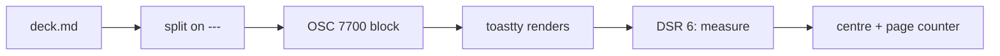

# toastty present

Markdown slides, rendered in your terminal

`toastty present examples/present/demo.md`

<!-- Speaker note: comments never reach the screen. -->

---

## How a deck is written

- One Markdown file, slides separated by a line holding only `---`
- Everything `toastty md` renders works on a slide
- Front matter at the top is skipped
- `<!-- comments -->` are hidden, so they can hold **speaker notes**

---

## Keys

| Key | Action |
| --- | --- |
| Space, →, l, PgDn | next slide |
| ←, h, PgUp | previous slide |
| g / G | first / last |
| `12` Enter | jump to slide 12 |
| r | reload (also automatic on save) |
| q, Esc | quit |

---

## Code

```rust
// Each slide is one OSC 7700 block.
for slide in split_slides(&source) {
    tty.write_all(&md_cmd::encode_osc(&slide, cwd))?;
}
```

---

## Maths

The OSC payload is base64, so a slide of n bytes costs

$$
\left\lceil \frac{n}{3} \right\rceil \times 4 \text{ bytes}
$$

---

## Diagrams



---

# Thanks

Questions?
